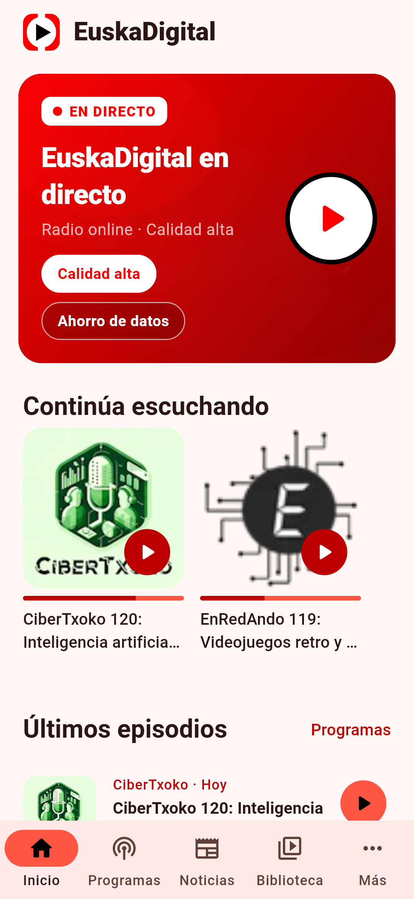
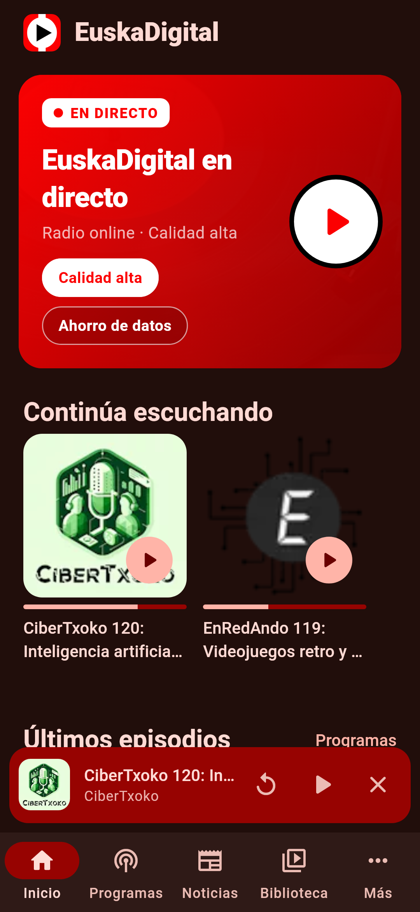
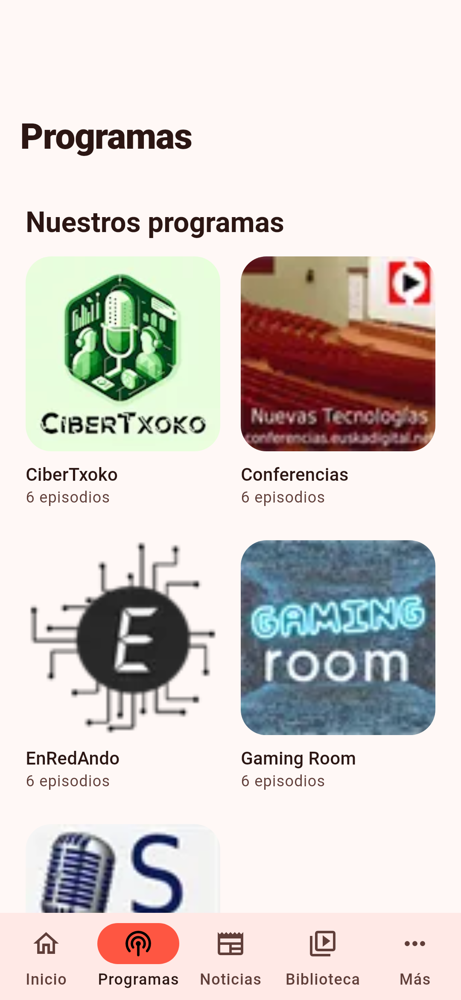
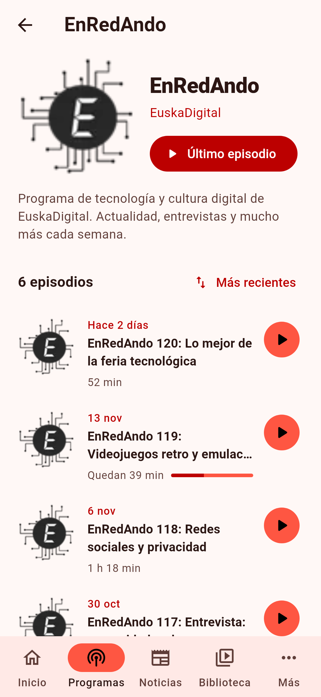
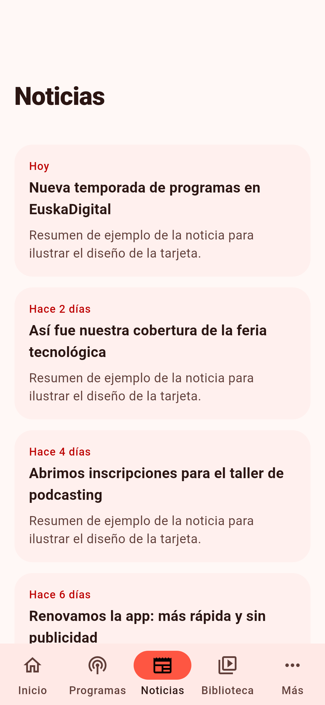
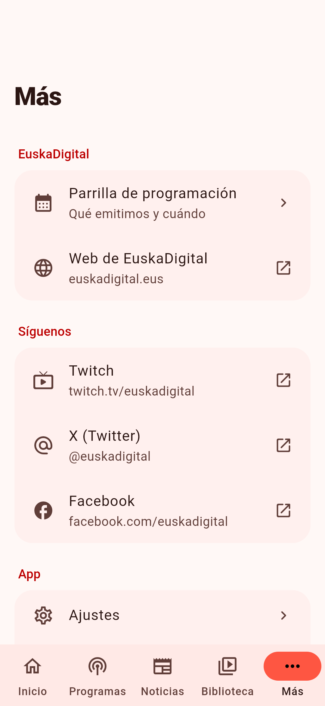

# EuskaDigital: app para Android e iOS

App de **EuskaDigital** con radio en directo, podcasts y noticias. Sustituye a la antigua app hecha con AppYet (servicio ya cerrado) y está escrita desde cero en **Flutter** con **Material 3**.

| Inicio | Inicio (oscuro) | Programas | Programa | Directo | Noticias | Más |
|---|---|---|---|---|---|---|
|  |  |  |  |  |  |  |

> Las capturas usan datos de ejemplo y las portadas de baja resolución de la app antigua. Con conexión, la app muestra los episodios reales y las portadas en alta resolución que vienen en los feeds.

## Funciones

- **Directo**: radio online con dos calidades (alta / ahorro de datos).
- **Podcasts**: 9 programas en dos grupos («Nuestros programas» y «También emitimos»), leídos de sus feeds RSS.
- **Reproductor**:
  - sigue sonando en segundo plano, con controles en la notificación, la pantalla de bloqueo y los auriculares;
  - recuerda por dónde ibas en cada episodio;
  - velocidad de 0,8× a 2×, saltos de −15 s / +30 s y temporizador para dormir.
- **Descargas** para escuchar sin conexión (por defecto solo con wifi).
- **Biblioteca**: en curso, favoritos, descargas e historial. Todo se guarda solo en el dispositivo.
- **Noticias** de euskadigital.eus con lectura integrada.
- **Parrilla de programación** (Google Calendar) y formulario de contacto dentro de la app.
- Enlaces a la web, Twitch, X y Facebook.
- **Tema claro, oscuro o automático**, transiciones con «atrás predictivo» en Android, icono temático (Android 13+) y pantalla de inicio nativa.
- Funciona sin conexión con la última copia descargada de cada feed.
- **Sin publicidad ni rastreadores**. La app antigua llevaba AdMob, Facebook Audience Network, Flurry y Firebase.

## Estructura

```
assets/config/app_config.json   ← programas, streams y enlaces (editar aquí)
assets/branding/                ← logo (vectorial .ai/.svg), icono y splash
lib/
  config/       carga de la configuración
  models/       Episode, FeedChannel
  services/     feeds RSS (lector + caché), reproductor, descargas, biblioteca, ajustes
  ui/           tema, estructura de pestañas, pantallas y componentes
test/           tests del lector RSS y generador de capturas
docs/           capturas y datos extraídos de la app antigua
```

### Añadir o quitar un programa

Edita `assets/config/app_config.json`: añade un objeto en `programGroups[].programs` con `id`, `title` y `feedUrl`; `fallbackImage` es opcional. No hace falta tocar código.

## Desarrollo

Requisitos: Flutter 3.35 o posterior y, para iOS, un Mac con Xcode.

```bash
flutter pub get
flutter run                 # en un emulador o dispositivo conectado
flutter test --exclude-tags screenshots
```

Regenerar iconos, pantalla de inicio o capturas:

```bash
dart run flutter_launcher_icons
dart run flutter_native_splash:create
flutter test test/screenshots --update-goldens --tags screenshots
```

GitHub Actions (`.github/workflows/ci.yml`) analiza el código, pasa los tests y compila el APK de Android (lo deja como artefacto descargable) y la versión de iOS sin firmar.

## Publicación

Identificador de la app: **`eus.euskadigital.app`** (Android e iOS). Es una app nueva, no una actualización de la de AppYet.

### Android (Google Play)

1. Crea la clave de firma una sola vez y **guárdala a buen recaudo**:
   ```bash
   keytool -genkey -v -keystore ~/euskadigital-upload.jks -keyalg RSA -keysize 2048 -validity 10000 -alias upload
   ```
2. Crea `android/key.properties` (está en `.gitignore`):
   ```properties
   storePassword=...
   keyPassword=...
   keyAlias=upload
   storeFile=/ruta/a/euskadigital-upload.jks
   ```
3. Genera el paquete y súbelo a Play Console. Activa *Play App Signing*.
   ```bash
   flutter build appbundle --release
   ```

### iOS (App Store)

1. Abre `ios/Runner.xcworkspace` en Xcode y elige tu equipo de desarrollador en *Signing & Capabilities*. La capacidad *Background Modes → Audio* ya está declarada.
2. Genera el archivo y súbelo con Xcode o Transporter:
   ```bash
   flutter build ipa --release
   ```

## Pendiente

- [ ] Comprobar que todos los feeds y streams siguen activos. Varios usan `http://`; están permitidos solo para esos dominios (`android/app/src/main/res/xml/network_security_config.xml` y `ios/Runner/Info.plist`). Conviene pasarlos a `https://`.
- [ ] Portadas en alta resolución para los programas sin `<itunes:image>` en su feed.
- [ ] Textos en euskera.
- [ ] Política de privacidad (Google Play y App Store la exigen aunque no se recojan datos).
