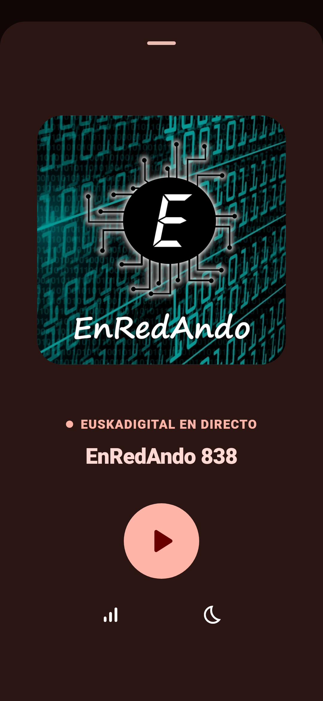

# EuskaDigital

App de EuskaDigital para Android e iOS: radio en directo, podcasts y noticias.

| | | | |
|---|---|---|---|
|  |  |  |  |

## Funciones

- Radio en directo
- Podcasts de los programas de EuskaDigital
- Reproducción en segundo plano, velocidad y temporizador
- Descargas para escuchar sin conexión
- Favoritos e historial
- Noticias y parrilla de programación
- Tema claro y oscuro

## Desarrollo

Hecha con [Flutter](https://flutter.dev).

```bash
flutter pub get
flutter run
```

Los programas, el directo y los enlaces se configuran en `assets/config/app_config.json`.

## Licencia

[GNU GPL v3](LICENSE). El logo y la marca EuskaDigital no están cubiertos por esta licencia.
